# AIO Vector Bot (Vectiq)

[](https://github.com/lucky-edgelord/aio-vector-bot/actions/workflows/ci.yml)
[](https://lucky-edgelord.github.io/aio-vector-bot/)

**Documentation: https://lucky-edgelord.github.io/aio-vector-bot/**

An all-in-one community bot for any Vector community. Clone it, give it its own key, edit `config.yaml`, run it. The package and command are called `vectiq`.

A community-management bot for [Vector](https://vectorapp.io), in the spirit of [Logiq](https://github.com/programmify/Logiq) (a Discord MEE6 alternative), written from scratch on `vector-sdk-py` with **SQLite** instead of MongoDB.

Moderation, leveling with image rank cards, an economy and shop, tickets, **CAPTCHA verification**, onboarding, reaction roles, giveaways, an event calendar, welcome messages, analytics, **WebXDC mini games** refereed by the bot, **webhooks you declare in YAML**, a **web dashboard**, a **setup wizard** (dashboard and terminal), settings **import and export**, and **restore points** you can roll back to.

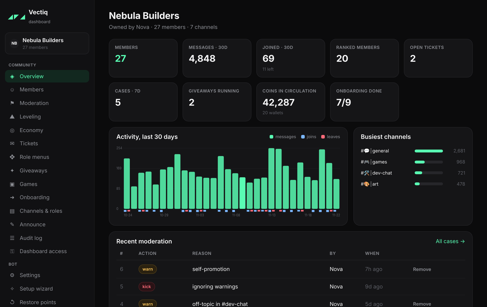

<p align="center">
  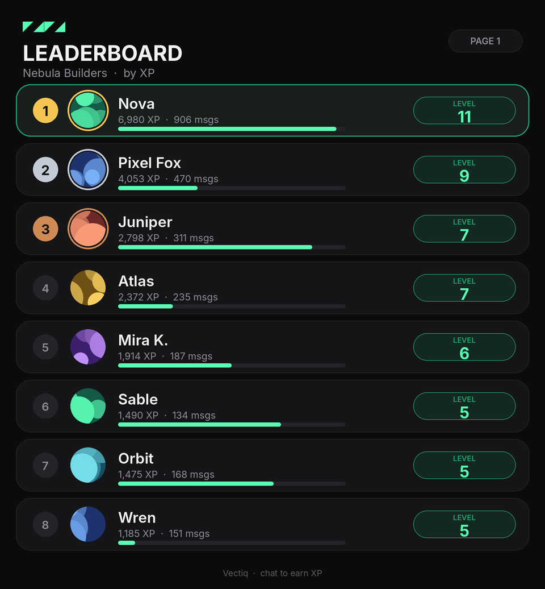
  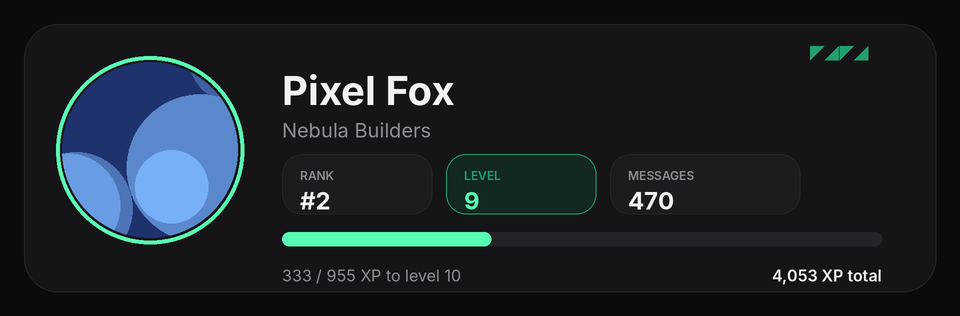
</p>
<p align="center"><sub>The leaderboard and rank cards members get in chat with <code>!leaderboard</code> and <code>!rank</code>.</sub></p>

<sub>All images show a made-up demo community. Regenerate them with <code>python tools/screenshots.py</code>.</sub>

```
src/vectiq/
  app.py, config.py, __main__.py      wiring, typed config.yaml loader, CLI
  db/        database.py, migrations.py     async SQLite facade + versioned schema
  stores/    one small class per feature (all SQL lives here)
  cogs/      one cog per feature (all Vector I/O lives here)
  games/     pure game rules + packager; apps/ holds the WebXDC front-ends
  render/    Pillow rank and leaderboard images
tests/       pytest: stores, rules, config, rendering, the referee cog
```

Rules never touch the network and stores never touch Vector, so almost everything is unit-tested without a live bot.

## Quick start

```sh
git clone https://github.com/lucky-edgelord/aio-vector-bot
cd aio-vector-bot
```

### macOS and Linux (e.g. a Mac mini)

```sh
./install.sh            # packages (Homebrew / apt / dnf / ...), Rust, venv, .env, launchd or systemd service
```

It asks for the bot's key (blank generates a new account) and optional community invite links. Then, in your Vector community, give the bot's account a role with the permissions it needs (Manage Roles, Manage Channels, Manage Messages, Moderate Members, Kick/Ban). Without them Vectiq still runs and tells you which permission is missing. Type `!help` anywhere.

Manual start: `./run.sh` (foreground), `./run.sh --check` (validate `config.yaml`), `./uninstall.sh`.
### Windows

```powershell
.\install.ps1          # winget: Python, Git, CMake, Rust, C++ build tools; venv; .env; scheduled task at logon
```

### Docker

```sh
echo 'VECTOR_NSEC=nsec1...' > .env
docker compose up -d          # settings in ./docker-config, data in ./docker-data
```

See the [Docker guide](docs/docker.md) for the setup wizard, ports and backups.

### pip / pipx

```sh
pipx install "vectiq[dashboard,webhooks] @ git+https://github.com/lucky-edgelord/aio-vector-bot"
mkdir my-bot && cd my-bot && vectiq --init && vectiq --setup
```

`--init` writes `config.yaml` and `.env` in the current folder; put the bot's `VECTOR_NSEC` in `.env`, then run `vectiq`.

### Linux

```sh
python3 -m venv .venv && .venv/bin/pip install -e ".[webhooks,dashboard]"
cp .env.example .env && chmod 600 .env    # put the bot's VECTOR_NSEC in it
.venv/bin/python -m vectiq --check && .venv/bin/python -m vectiq
```

The SDK (`vector-sdk-py`) is installed from [GitHub](https://github.com/lucky-edgelord/vector-sdk-py) and compiled from Rust on first install, so you need `rustc`/`cargo` and `cmake` (the macOS installer gets them from Homebrew), and the first install takes several minutes.

Use a **separate Vector account for the bot**, never your personal key.

## What was ported from Logiq

| Logiq | Vectiq | Notes |
|---|---|---|
| Moderation | `moderation` | warn/delwarn/clearwarns, timeout, kick, ban, tempban (auto-lifts), unban, purge, lock/unlock, soft slowmode, cases + history, automod |
| Leveling | `leveling` | MEE6 curve, cooldown, level-up messages, role rewards, **image rank card and leaderboard** |
| Economy | `economy` | wallet + bank, daily streaks, work, pay, shop with roles and stock, rich list, transaction history |
| Tickets | `tickets` | private channel per ticket, claim, close by command or 🔒 reaction, stored transcript |
| Web dashboard | `dashboard` | FastAPI dashboard with username/password logins tied to Vector admin roles (off by default) |
| Verification | `verification` | arithmetic question or a ✅ reaction |
| Role menus | `roles` | reaction roles, add and remove |
| Giveaways | `giveaways` | react 🎉, timed, multiple winners, reroll |
| Welcome | `welcome` | templated join/leave messages |
| Games | `games` | Tic-Tac-Toe, Connect Four, Trivia, Slots as **WebXDC mini apps** |
| Utilities / analytics | `utility` | userinfo, poll, activity chart |
| Events | `events` | event calendar: RSVPs, waitlists, repeats, reminders (channel + DM), banner pictures, month picture, .ics |
| Security cam | `securitycam` | echo every message (author, channel, time, text, attachments) into one staff channel; off by default |
| (new) | `onboarding`, `webhooks` | welcome → verify → pick roles; YAML-declared webhooks |

Not ported: music, Twitch/YouTube/Twitter alerts, temporary voice channels and the web dashboard. They don't map onto Vector (or were off in Logiq).

## Configuration: `config.yaml`

Every feature is a module you can switch off, and every number is a setting. `!vectiq reload` re-reads it (turning a module on or off needs a restart). Secrets stay in `.env`. `python -m vectiq --check` validates the file and gives a clear error for mistakes.

### Webhooks from YAML

```yaml
webhooks:
  server:
    enabled: true                    # also serve the HTTP endpoint so GitHub, Grafana, CI... can post
    base_url: "https://hooks.example.com"
  hooks:
    - name: deploys                  # unique name
      channel: deploys               # channel name or id
      notify: [owners]               # who is DMed the secret URL when it is created (owners | npub...)
      events: [mod, levels]          # Vectiq events mirrored into the channel
```

On start (and `!webhooks sync`) Vectiq creates the missing hooks, DMs you each URL **once** (tokens are stored hashed, so a lost URL is replaced with `!webhooks rotate <name>`), and mirrors the listed events into the channel: `mod`, `joins`, `leaves`, `levels`, `tickets`, `giveaways`, `games`, `onboarding`. Hooks use the SDK's Discord-compatible format, so any tool that can post to a Discord webhook works by swapping the URL. Enabling the server needs `pip install "vector-sdk-py[webhooks]"` (the installer does this) and HTTPS in front of it.

### Event calendar

```
!event create Game night | friday 8pm | 2h | Bring snacks
```

Times can be typed as `friday 8pm`, `tomorrow 18:30`, `nov 20 7pm`, `2026-11-20 20:00` or `in 2h`, read in the community's time zone (`events.timezone`, or `!event timezone America/New_York`). Each event goes to the announcements channel (`events.channel`; `announcements` finds `📣┊Announcements`): the details, then a picture, then the footer where members react ✅ going, 🤔 maybe or ❌ can't go. The picture is a drawn banner, or whatever you attach to the command (`!event edit <id> image` with a picture changes it later). The post updates as people answer; with `capacity` set, extra people go on a waitlist and move up when someone drops out.

Before it starts, a general reminder (no pings, with the picture) goes in the channel and a personal reminder goes by DM to everyone going or maybe (`events.reminders`, default 60 and 15 minutes). Repeating events (`!event edit <id> repeat weekly`) post a fresh RSVP list for each occurrence. `!calendar` shows the month as a picture, `!event ics <id>` and `!calendar ics` give calendar files for Google, Apple and Outlook.

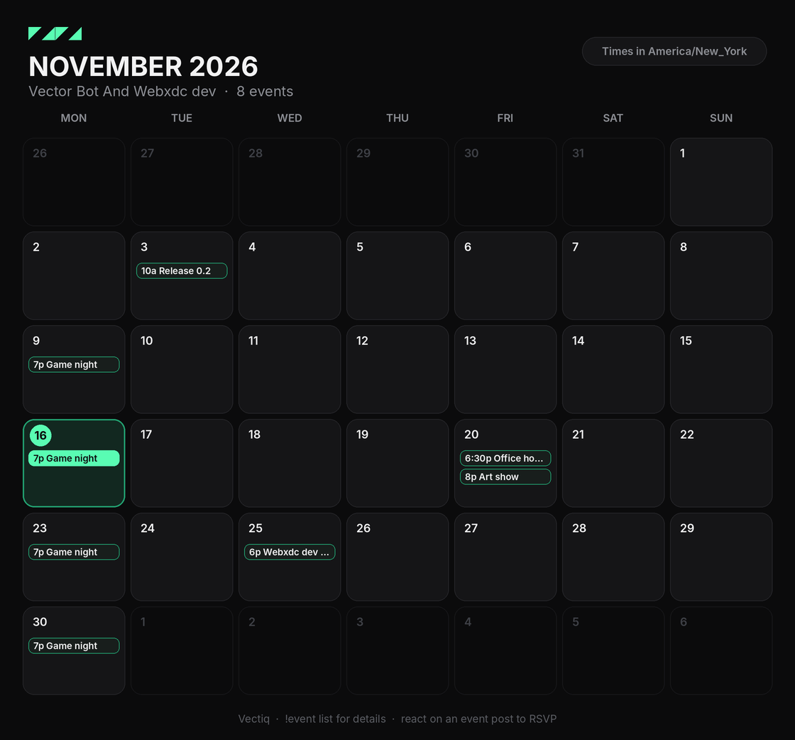

### Setup wizard

`python -m vectiq --setup`, or **Setup wizard** on the dashboard: the bot asks what it needs, one question per screen, like an installer, and skips what doesn't apply. The terminal version writes `config.yaml` and keeps every comment.

<p align="center">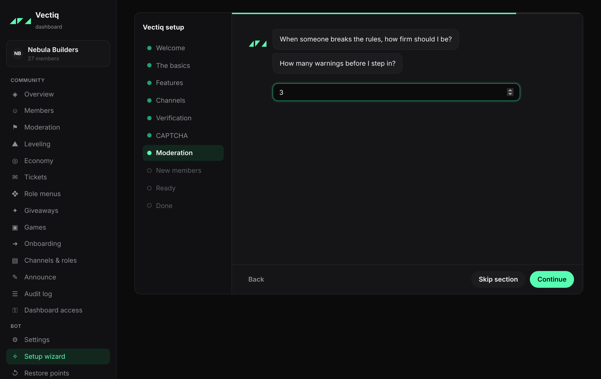</p>

### Verification

A question, a ✅ reaction, or a **CAPTCHA web page** reached by a personal one-time link. Optional: hide messages until people verify, one verification per device (hashed IP, cookie and browser marks), a minimum age with an adults-only role, a lobby that invites verified members to the real community, and softbans that kick on sight and escalate to a ban. See [Verification](https://lucky-edgelord.github.io/aio-vector-bot/verification.html).

### Restore points and settings files

Like System Restore: the database, `config.yaml`, dashboard settings and event pictures are saved daily and before risky changes (imports, the wizard, upgrades, rollbacks), and you can make your own. Roll back from the dashboard, chat (`!restorepoint`) or the terminal (`--restore`); a rollback can itself be undone. Settings export and import as YAML, with a preview of every change (`--export-config`, `--import-config`, or Settings on the dashboard). The bot's key is never included in either.

### Security cam

Turn on `modules.securitycam`, then run `!securitycam set #channel` (Manage Server), or pick the channel on the dashboard's Security cam page. Every message in every other channel is copied there: the author's name and text, then any attachments, then the source channel and time. The camera channel itself and the bot's own messages are never echoed; other bots are skipped unless `securitycam.include_bots` is on, and you can skip channels in config.yaml or on the dashboard. **Make the camera channel staff-only** — it shows everything.

### Onboarding

```yaml
onboarding:
  steps: [verify, pick_roles]
  role_menu: { "🎮": Gamer, "🎨": Artist, "💻": Dev }   # roles are created if missing
  required: false        # true: only complete once they pick a role
```

New member → welcome → verification → a role menu built from the YAML (the same reaction roles as `!rolemenu`) → done message. Progress is stored per member and finishing fires an `onboarding` event.

## Web dashboard

A FastAPI dashboard runs inside the bot. Turn it on with `modules.dashboard: true`, restart, and open `http://localhost:8090`.

<p align="center">
  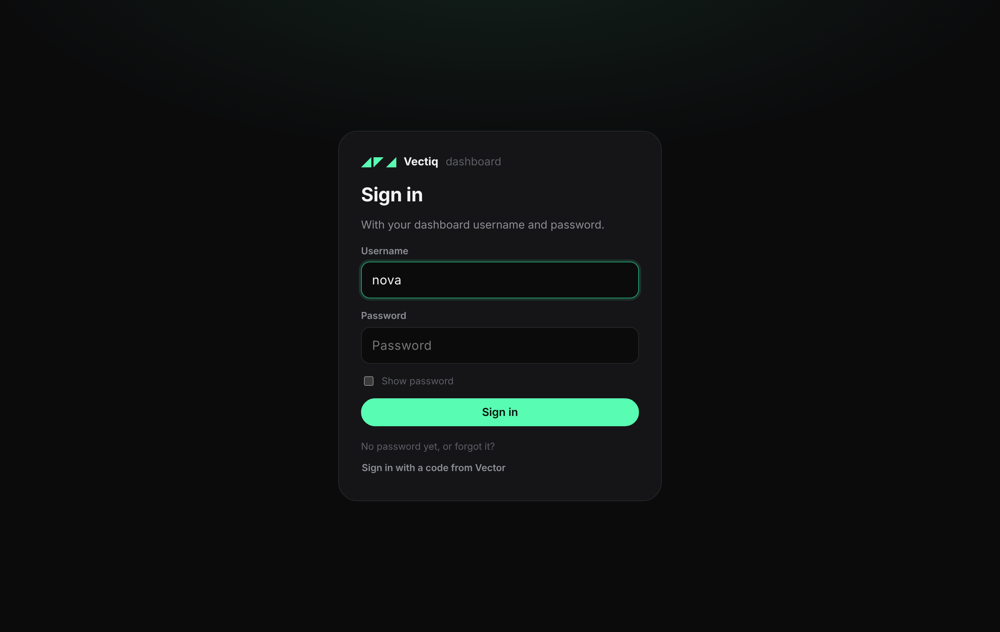
  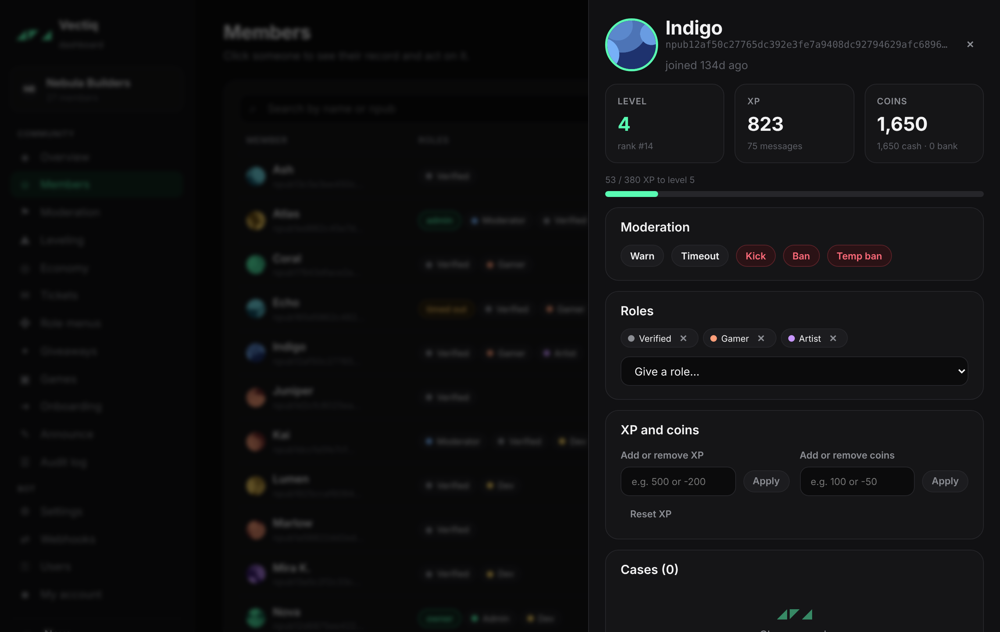
</p>
<p align="center">
  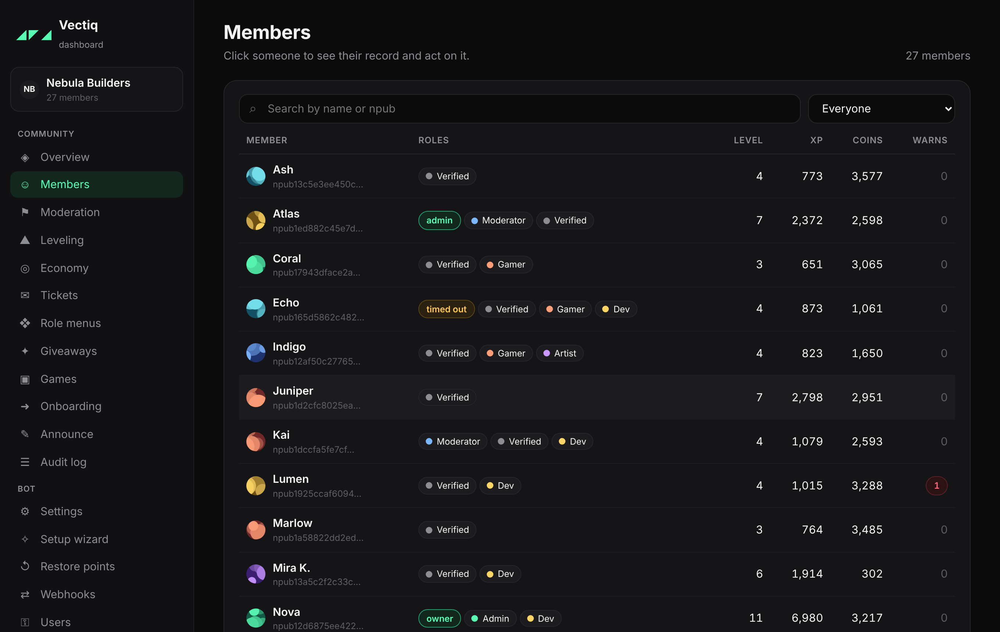
  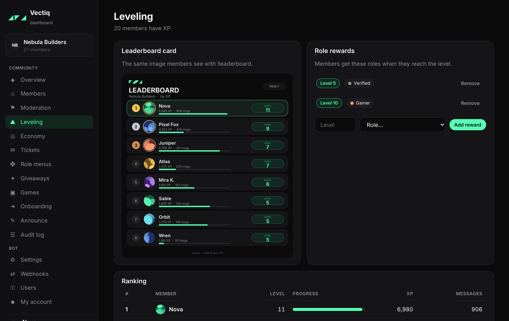
</p>
<p align="center">
  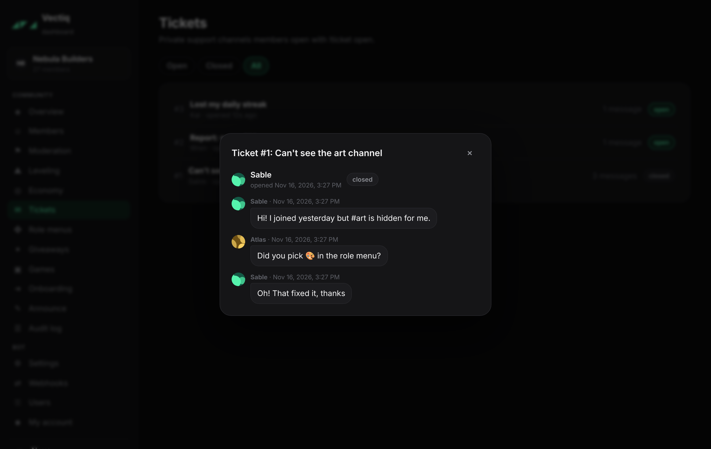
  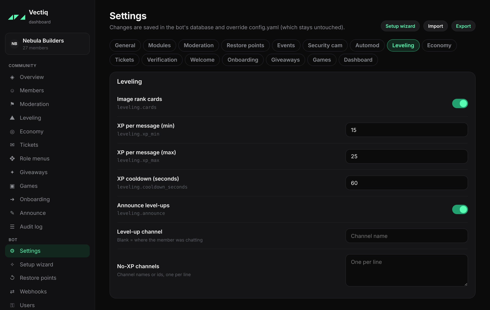
</p>
<p align="center">
  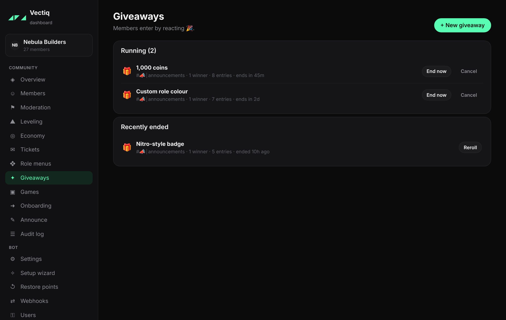
  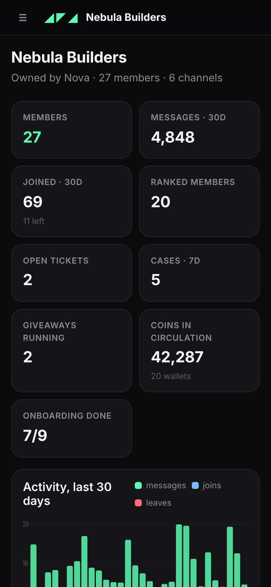
</p>

**Signing in** is by username and password. Every login belongs to a Vector account (npub), and that account's admin role in Vector decides which communities it can manage, checked on every request: remove someone's admin role and their dashboard access goes with it.

```sh
.venv/bin/python -m vectiq --add-user alice --npub npub1...    # asks for the password (10+ characters)
.venv/bin/python -m vectiq --list-users
.venv/bin/python -m vectiq --set-password alice                # also unlocks a locked account
.venv/bin/python -m vectiq --delete-user alice
```

Owners can also create logins on the **Users** page, and anyone signed in can change their password on **My account**. As a fallback (no password yet, or forgot it) admins can get a one-time code by Vector DM from the sign-in page or with `!dashboard`; turn that off with `dashboard.vector_code_login: false`.

**Pages:** overview with 30-day activity, members (warn, timeout, kick, ban, roles, XP, coins, full record), moderation cases and bans, leveling and role rewards (with the leaderboard card), economy and shop, tickets with transcripts, role menus, giveaways, games, onboarding, announcements, an audit log of every dashboard action, settings, webhooks and users.

**Settings** edited in the dashboard are saved in the database and layered over `config.yaml`, which is never rewritten (its comments stay). Each changed setting shows a "dashboard" tag and can be reset to the file's value; **Export YAML** downloads the merged result. Module switches and the dashboard's own address need a restart.

**Security:** passwords are hashed with scrypt; five wrong passwords lock a login for 15 minutes; sign-in is rate-limited per IP; sessions are HttpOnly, SameSite=Strict cookies stored hashed; every change needs a same-origin header (no CSRF); the pages send a strict Content-Security-Policy. It listens on `127.0.0.1` by default. To reach it from elsewhere, put it behind HTTPS (for example `caddy reverse-proxy --from dash.example.com --to 127.0.0.1:8090`, or Tailscale) and set `dashboard.base_url` to the `https://` address so cookies are marked Secure.

## Commands

| Area | Commands |
|---|---|
| Moderation | `warn` `warnings` `delwarn` `clearwarns` `timeout` `untimeout` `kick` `ban` `tempban` `unban` `case` `history` `modlog` `purge` `lock` `unlock` `slowmode` |
| Leveling | `rank` `leaderboard` `levelreward add/remove` `givexp` `resetxp` `levelcurve` |
| Economy | `balance` `daily` `work` `pay` `deposit` `withdraw` `richest` `transactions` `shop` `buy` `inventory` `addmoney` |
| Dashboard | `dashboard` (DMs you a one-time sign-in link) |
| Tickets | `ticket open/close/claim/list/transcript`, or react 🔒 in the ticket to close (`tickets.close_emoji`) |
| Roles & access | `rolemenu create/list/delete` `verify` `forceverify` `onboarding` |
| Giveaways | `giveaway start/end/reroll/cancel/list` |
| Games | `games` `play <game>` `gamestats` `gameboard` |
| Utility | `userinfo` `communityinfo` `poll` `analytics` `testwelcome` `about` `ping` |
| Events | `event create` `event list` `event info` `event edit` `event rsvp` `event who` `event cancel` `event delete` `event repost` `event ics` `event timezone` `calendar` |
| Security cam | `securitycam` `securitycam set [channel]` `securitycam off` |
| Owner | `vectiq reload/stats`, `webhooks`, `webhooks sync/rotate/test` |

Moderation commands are gated by the matching Vector permission. Owner commands use `owners:` in `config.yaml`.

## Mini games (WebXDC)

`!play tictactoe | connect4 | trivia | slots` posts a small web app into the chat. Players open it in Vector and **the bot joins the app's realtime channel as the referee**: it owns the board, the clock, the random numbers and the coins, so a modified client can't cheat.

- Tic-Tac-Toe and Connect Four: two seats, spectators welcome, rematch.
- Trivia: lobby, 8 timed questions, faster correct answers score more; coins per correct answer.
- Slots: bet your real wallet; wins and losses are written to SQLite.
- Winners are paid (`games.winner_coins`) and recorded for `!gamestats` / `!gameboard`.
- The bot only acts on **verified** senders (frames that arrive directly from a player's device). A relayed frame is asked to retry. `games.allow_unverified` exists for testing only: leave it off.

Add a game: write `games/<name>.py` (a `Game` subclass), a front-end in `games/apps/<name>/` (`index.html`, `manifest.toml` with `id = "vectiq-<name>"`, `icon.png`) and register it in `games/registry.py`.

## Data

One SQLite file at `data/vectiq.db` (WAL mode). The schema is versioned in `db/migrations.py` and applied on start; never edit an applied migration, append a new one. Back it up with `sqlite3 data/vectiq.db ".backup backup.db"`. All ids are `TEXT` (Vector uses npub/hex strings).

## Development

`python tools/screenshots.py --chrome /path/to/chrome` rebuilds the images in `docs/images/` from a made-up demo community (needs `pip install playwright`).

```sh
pip install -e ".[dev]" && pytest && ruff check .
```

## Credits

- **[GateBot](https://gitworkshop.dev/henk.tech/Gatebot)** by henk.tech (MIT): the CAPTCHA verification flow (personal one-time links, the domain-only public notice, the age step), one verification per device with expiring hashed IP, cookie and browser marks, the message gate with a spam limit, the invite-gate lobby, softbans that kick on sight and escalate to a real ban, lasting verification records with role restore on rejoin, and the permission check. Vectiq's version is a Python rewrite of those ideas, not a copy of the code.
- **[Logiq](https://github.com/programmify/Logiq)**: the feature set Vectiq started from.

## Contributing

Issues and pull requests are welcome; see [CONTRIBUTING.md](CONTRIBUTING.md).

## Known limits

- The macOS installer and launchd agent have not yet been run on a real Mac; reports welcome.
- Communities still on Vector's legacy roster don't accept per-channel permission overwrites. Tickets fall back to a private channel with per-member access; `lock`/`unlock` may need the community upgraded.
- The rank and leaderboard colours approximate Vector's look (dark canvas, green accent, ◤◢ motif); change them in `render/cards.py`.
- Games were verified with the real rules driven through a headless browser and with the cog tested against a fake session. A full two-player round trip over Vector's network has not yet been confirmed from a real Vector client.
- Fonts: Inter (SIL OFL) is bundled for the cards; see `assets/fonts/Inter-OFL.txt`.
