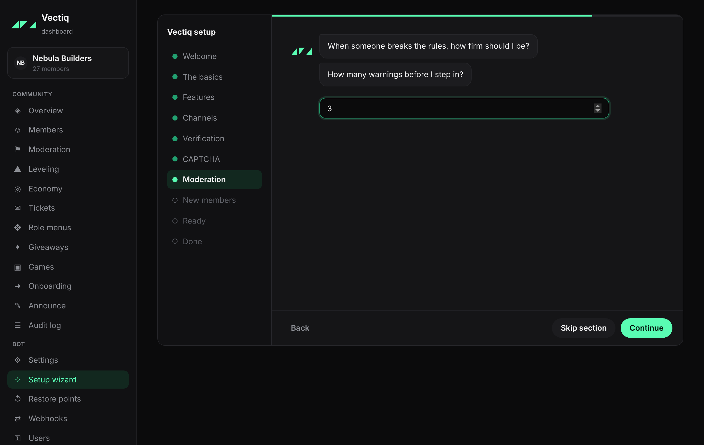

Everything about how Vectiq behaves is in one file, `config.yaml`, in the folder you cloned. Every setting has a comment next to it, and the full list with defaults is in the [settings reference](config-reference.md).

## The setup wizard

The quickest way to set the bot up is to let it ask you. It goes step by step, one question per screen, like an installer: what the bot should do, which channels to post in, how to verify new members, how firm to be with rule breakers, and what new members see. Questions that don't apply are skipped, you can go back at any point, and nothing changes until you confirm.



- **On the dashboard:** **Setup wizard** in the menu (bot owners). It offers your community's channels to pick from and, once saved, tells you if anything is still missing, like a permission.
- **In the terminal:** `python -m vectiq --setup`. It writes your answers into `config.yaml` and keeps every comment, with the old file saved as `config.yaml.bak`. The installer offers to run it.

```text
┌ Vectiq setup · Channels ───────────────── ■■■■□□□□□□□□□□□□ 5/27 ┐
│                                                                  │
│ Vectiq › Where should I write down warnings, kicks and bans?     │
│                                                                  │
│ Now: default                                                     │
│ (a channel name, - for default)                                  │
└──────────────────────────────────────────────────────────────────┘
Enter: keep and continue   <: back   s: skip section   q: quit
```

A restore point is made before the wizard saves, so you can [roll back](restore-points.md) if you change your mind.

## Changing settings by hand

1. Edit `config.yaml`.
2. Check it: `python -m vectiq --check` (or `./run.sh --check` on a Mac). A mistake gets a plain message such as `events.timezone: unknown time zone 'Mars/Base'` instead of a crash.
3. Apply it. Most changes take effect when you run `!vectiq reload` in chat (bot owners only). Turning a module on or off needs a restart.

!!! note "Restart on a Mac"
    The installer runs the bot as a login item. Restart it with `launchctl kickstart -k gui/$(id -u)/com.vectiq.bot`.

## Modules

Each feature is a module with a switch under `modules:`. Switch off what you don't need and its commands, background jobs and database tables stay idle.

```yaml
modules:
  moderation: true
  leveling: true
  events: true
  securitycam: false      # off until you want it
  dashboard: false
```

The security cam and the dashboard start switched off because they are the two features that need a deliberate decision. See the [modules table](config-reference.md#modules) for the full list.

## Who can do what

Vectiq checks permissions against Vector itself. A moderator needs the matching Vector permission to use a moderation command, so there is no separate permission list to keep in sync.

Some commands are for the person running the bot rather than for community staff (`!vectiq reload`, `!webhooks`). They work for the accounts listed under `owners`:

```yaml
owners:
  - npub1...your own account...
```

If `owners` is empty, nobody has owner rights, so set it once you know your npub.

## Secrets

Keys and tokens stay out of `config.yaml`. They live in `.env`, which is created from `.env.example` and should only be readable by you (`chmod 600 .env`):

| Variable | What it is |
|---|---|
| `VECTOR_NSEC` | The bot's account key. Required. |
| `VECTIQ_INVITE_URLS` | Community invite links the bot joins once, separated by spaces. |
| `VECTIQ_DATA_DIR` | Where the database and the bot's identity are kept. Defaults to `data`. |
| `WEBHOOKS_ADMIN_KEY` | Optional key that protects the webhook admin endpoint. |

## Settings changed in the dashboard

If you use the [dashboard](dashboard.md), settings you change there are saved in the database and layered on top of `config.yaml`. The file itself is never rewritten, so your comments stay. Each changed setting shows a "dashboard" tag and can be reset to the value in the file.

## Exporting and importing settings

An export is every setting, with dashboard changes applied, as one YAML file. Use it to copy your setup to another bot, keep it in version control, or move dashboard changes back into `config.yaml`. The bot's key is never in it.

| | Dashboard (Settings) | Terminal |
|---|---|---|
| Export | **Export** | `python -m vectiq --export-config my-settings.yaml` (or `-` to print it) |
| Import | **Import**, pick the file | `python -m vectiq --import-config my-settings.yaml` |

An import always shows you first exactly what would change, setting by setting, and anything it can't use (a mistyped key, an invalid value) is listed instead of applied. A restore point is made before anything changes.

The dashboard imports the settings it can edit, as dashboard changes. The terminal writes into `config.yaml` itself, keeping the comments, and can import everything, including webhooks and level rewards.

## Per-community settings

Channel settings match names loosely: `mod-log` finds `🛡┊mod-log`, and `announcements` finds `📣┊Announcements`. You can also use a channel's id.

A few things are set per community, from chat, because they differ between communities: the event time zone (`!event timezone`), the security cam channel (`!securitycam set`) and role menus. Everything else in `config.yaml` applies to every community the bot serves.

## All settings

{{config:general}}

Every other section of the file has its own table on the [settings reference](config-reference.md) page, and the guide for each module explains the settings that matter most.
