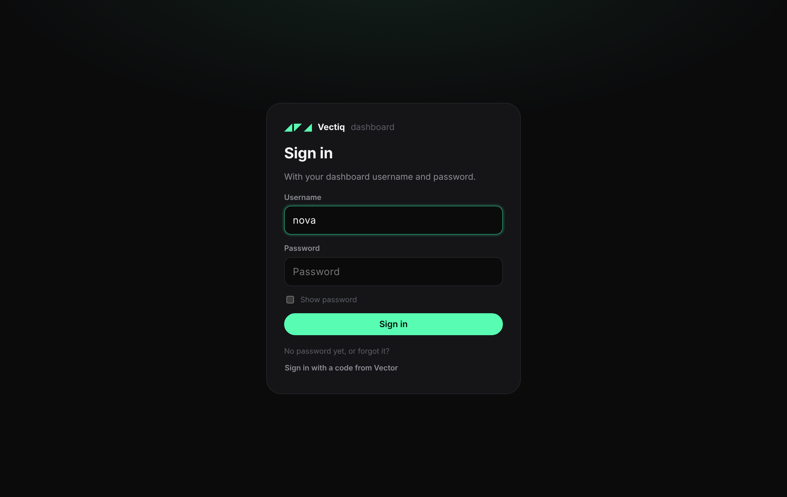
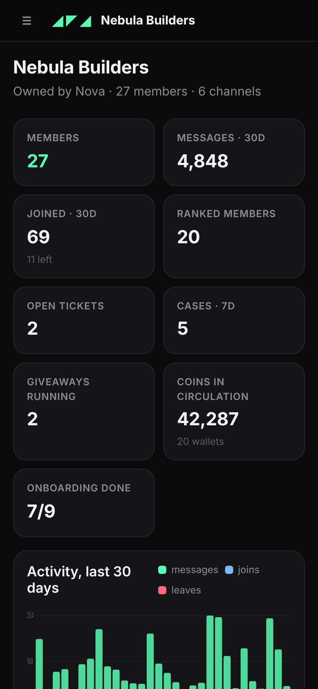

The dashboard is a web page where staff manage the bot without typing commands. Everything it does is also available as a chat command, and every change is recorded in the audit log.

## Turning it on

```yaml
modules:
  dashboard: true
dashboard:
  host: 127.0.0.1
  port: 8090
  base_url: "http://localhost:8090"
```

Restart the bot and open `http://localhost:8090`. With `host: 127.0.0.1` only the computer running the bot can reach the page. To use it from elsewhere, put HTTPS in front of it and set `base_url` to the public address. See [Deployment](deployment.md#the-dashboard-and-webhooks-over-https).

## Signing in



There are two ways in. Only admins of a community the bot serves, and the bot's `owners`, can sign in.

**Username and password.** Create a login on the machine running the bot, tied to your Vector account:

```sh
vectiq --add-user sam --npub npub1...   # asks for a password of 10+ characters
vectiq --list-users
vectiq --set-password sam
vectiq --delete-user sam
```

**A code from Vector.** Enter your npub on the sign-in page and the bot sends a one-time code by DM that works for `dashboard.code_minutes` (10) minutes. You can also type `!dashboard` in chat to get a sign-in link by DM. Turn this off with `dashboard.vector_code_login: false` if you only want passwords.

A sign-in lasts `dashboard.session_days` (7) days. Too many wrong attempts are slowed down, and an npub that isn't allowed gets the same answer as one that is, so nobody can probe for accounts.

## What is on each page

| Page | What you can do |
|---|---|
| Overview | Messages, joins and leaves per day, and your busiest channels |
| Members | Search members, open one to see their level, coins and warnings, and adjust them |
| Moderation | Cases, active timeouts and bans, filters, and the log channel |
| Leveling | The leaderboard, XP settings, level rewards and no-XP channels |
| Economy | Balances, the shop and the richest members |
| Tickets | Open and closed tickets, with the full transcript of each |
| Role menus | Create and edit role menus |
| Giveaways | Start, end and reroll giveaways |
| Games | Results and leaderboards for each game |
| Onboarding | The welcome message, verification and onboarding steps |
| Security cam | Choose the channel and the channels to leave out |
| Announce | Post a message as the bot into any channel |
| Audit log | Who changed what, and when |

Pages only appear for features that are turned on.


## Settings


The Settings page edits the values in [config.yaml](configuration.md) for a community. A value you change here is saved on top of the file, so it takes effect without a restart and survives updates. Reset a value to go back to the file's setting.

Some settings only apply when the bot starts, such as the dashboard's own address. The page tells you when a restart is needed.

## On a phone

The dashboard works on a narrow screen: the menu folds away and tables become lists.



## Safety

- Sign-in codes and links work once and expire.
- Pages that change something need a signed-in session and check your role in that community on every request.
- Every change is written to the audit log with who made it.
- Nothing about the dashboard is open to the internet unless you put it there. Keep `host: 127.0.0.1` unless you have HTTPS in front.

## Settings

{{config:dashboard}}
