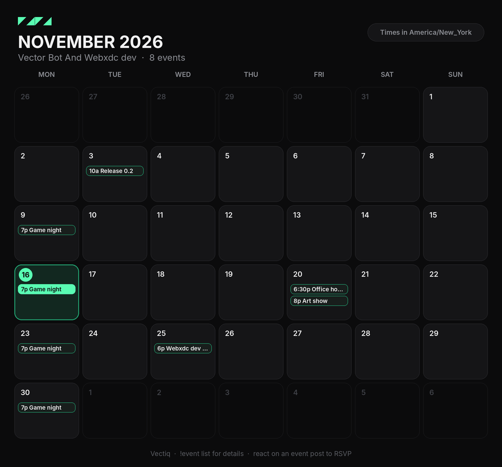
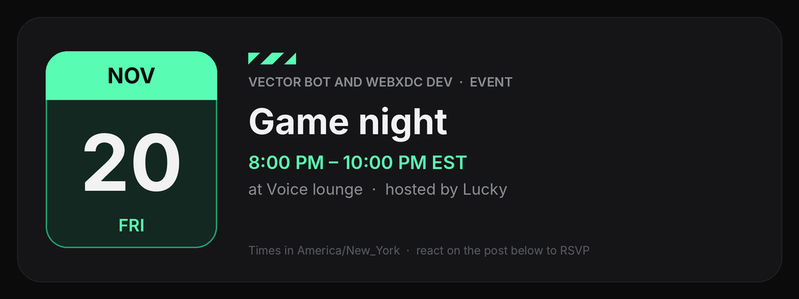

Schedule an event with one message and members RSVP with a reaction. The bot posts it in your announcements channel, reminds people before it starts and can keep a calendar of everything coming up.

```
!event create Game night | friday 8pm | 2h | Bring snacks
```



## Creating an event

The format is `title | when | length | description`. Only the title and the time are required.

**When** can be written the way you would say it: `friday 8pm`, `tomorrow 18:30`, `nov 20 7pm`, `2026-11-20 20:00`, `11/20`, `in 2h`, `tonight` or `noon`. A day with no time means noon. A time that has already passed today means tomorrow, and a weekday that has passed means next week. If the bot can't read it, it says so and gives examples.

**Length** is `2h`, `90m` or `1h30m`. Without one, the event lasts `events.default_minutes` (60). An event lasts between a minute and 14 days.

Times are read in the community's time zone, so set it once:

```
!event timezone America/New_York
```

The default is UTC, and you can change that for every community in `config.yaml` with `events.timezone`. An event keeps the zone it was created in, so changing the zone later doesn't move existing events.

By default only staff (people with Manage Messages) can create events. Set `events.who_can_create: everyone` to open it up.

## What gets posted

Events go to your announcements channel, so members find them in one place. Set the name in `config.yaml`:

```yaml
events:
  channel: announcements
```

The name is matched loosely, so `announcements` finds `📣┊Announcements`. Leave it blank and the event is posted in the channel where the command was typed.

The post has three parts, in this order: the details, then a picture, then a footer. Members react on the footer.

1. **The details:** title, description, when, where, who is hosting, and who is going, maybe or can't go. It updates as people answer.
2. **The picture:** a banner the bot draws with the date, title and time, or a picture of your own.
3. **The footer:** `Event #4`, the start time in each reader's own time zone, and the reactions ✅ going, 🤔 maybe and ❌ can't go.



### Using your own picture

Attach an image to the command and the bot uses it in place of the drawn banner:

```
!event create Art show | saturday 3pm | 2h | Bring your best pixel art
```

To change it later, attach a picture to `!event edit 4 image`. To go back to the drawn banner, use `!event edit 4 image none`. To stop drawing banners at all, set `events.banner_image: false`. PNG, JPEG, GIF and WebP up to 8 MB work.

## RSVPs

Members react ✅, 🤔 or ❌ on the footer. The newest reaction wins, so choosing 🤔 after ✅ changes their answer, and taking a reaction back clears it. They can also type `!event rsvp 4 going` (or `maybe`, `no`, `leave`). `!event who 4` lists everyone who answered.

Set a limit and extra people go on a **waitlist** instead of being turned away. When someone drops out, the next person moves up on their own:

```
!event edit 4 capacity 8
```

## Reminders

Before an event starts, the bot does two different things.

- **A general reminder in the channel.** It carries the event's picture and the number of people going. It doesn't ping anyone, so it stays quiet for people who aren't interested.
- **A personal reminder by DM** to everyone who is going or maybe. If someone's DMs are closed, they simply don't get it.

The defaults are 60 and 15 minutes before. Change them for every event, or per event:

```yaml
events:
  reminders: [1440, 60, 15]     # a day, an hour and a quarter hour before
  dm_reminders: true
```

```
!event edit 4 remind 1d, 30m
!event edit 4 remind none
```

When an event starts, the channel gets a "starting now" post and people going get a DM. If the bot was off for more than ten minutes when a reminder was due, that reminder is skipped instead of arriving late.

Cancelling an event posts a notice in the channel and sends a DM to everyone who had answered going, maybe or on the waitlist.

## Repeating events

```
!event edit 4 repeat weekly
```

Choose `daily`, `weekly`, `biweekly`, `monthly` or `none`. When a repeating event ends, the old post is kept as a record and a fresh one appears for the next time, with a clean RSVP list. Repeats stay at the same clock time through daylight saving changes, so a 7 PM event stays at 7 PM. A monthly event on the 29th to 31st lands on the last day of shorter months and continues from there.

If the bot was off for a while, a repeating event skips the occurrences it missed instead of posting them all at once.

## Changing and removing events

| To do this | Type |
|---|---|
| Change a detail | `!event edit 4 <field> <value>` |
| Move it | `!event edit 4 when saturday 7pm` |
| Cancel it, with a note | `!event cancel 4 Venue is closed` |
| Delete it and its post | `!event delete 4` |
| Post it again here | `!event repost 4` |

The fields you can edit are `title`, `when`, `length`, `description`, `location`, `repeat`, `remind`, `capacity`, `channel` and `image`. The host and staff can edit and cancel an event. Only staff can delete one. A cancelled event stays on the channel, marked cancelled.

## The month calendar

`!calendar` posts this month as a picture, with up to three events on each day. Look further ahead with `!calendar next`, `!calendar december` or `!calendar 2027-01`. Choose which day the week starts on with `events.week_starts`.

## Calendar files

Members can add events to Google Calendar, Apple Calendar or Outlook:

- `!event ics 4` sends a file for one event, with its reminders and repeat rule.
- `!calendar ics` sends one file with every upcoming event.

## Roles for attendees

Turn on `events.attendee_roles` and each event gets a temporary role, given to everyone going, so you can ping just them. The role is deleted when the event ends. The bot needs Manage Roles.

## Other tools

Events send `events` messages to [webhooks](webhooks.md), so you can mirror new events, reminders and cancellations into another channel. Settings for the calendar are in the Events tab of the [dashboard](dashboard.md) settings.

## Commands

{{commands:Events}}

## Settings

{{config:events}}
