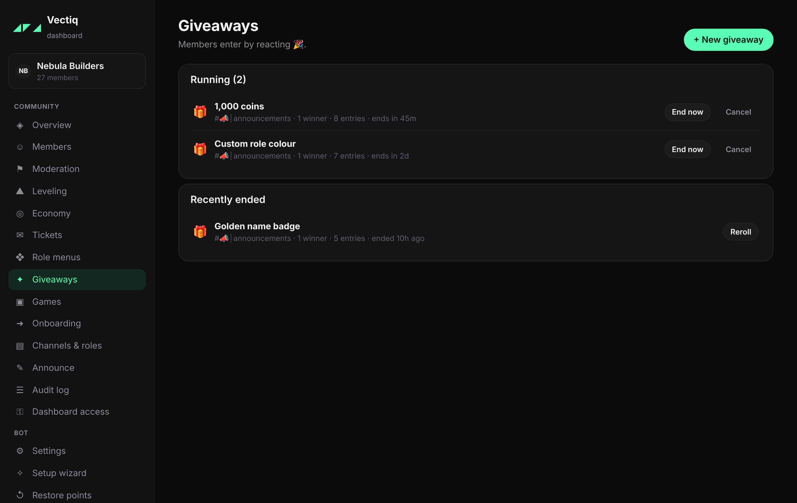

```
!giveaway start 1h 2 Nitro
```



That starts a one-hour giveaway for a prize called "Nitro" with two winners. The bot posts it with a 🎉 reaction, members react to enter, and when time is up the bot picks the winners at random and announces them.

## Running one

| To do this | Type |
|---|---|
| Start a giveaway | `!giveaway start <time> <winners> <prize>` |
| Finish one now | `!giveaway end <id>` |
| Draw a replacement winner | `!giveaway reroll <id>` |
| Stop one without picking winners | `!giveaway cancel <id>` |
| See what's running | `!giveaway list` |

Time is written as `30m`, `2h` or `1d`. All of them except `list` need Manage Messages. Taking your reaction back leaves the giveaway, and you can enter again until it ends.

You can also start giveaways from the [dashboard](dashboard.md), which shows entry counts as people join.

## Limits

```yaml
giveaways:
  max_winners: 10
  min_minutes: 1
```

## Commands

{{commands:Giveaways}}

## Settings

{{config:giveaways}}
