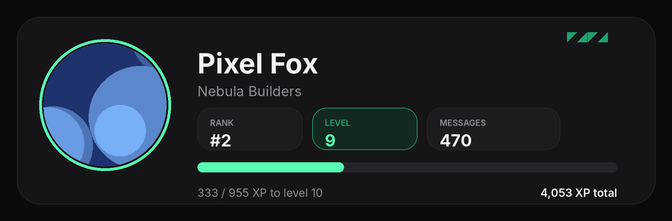
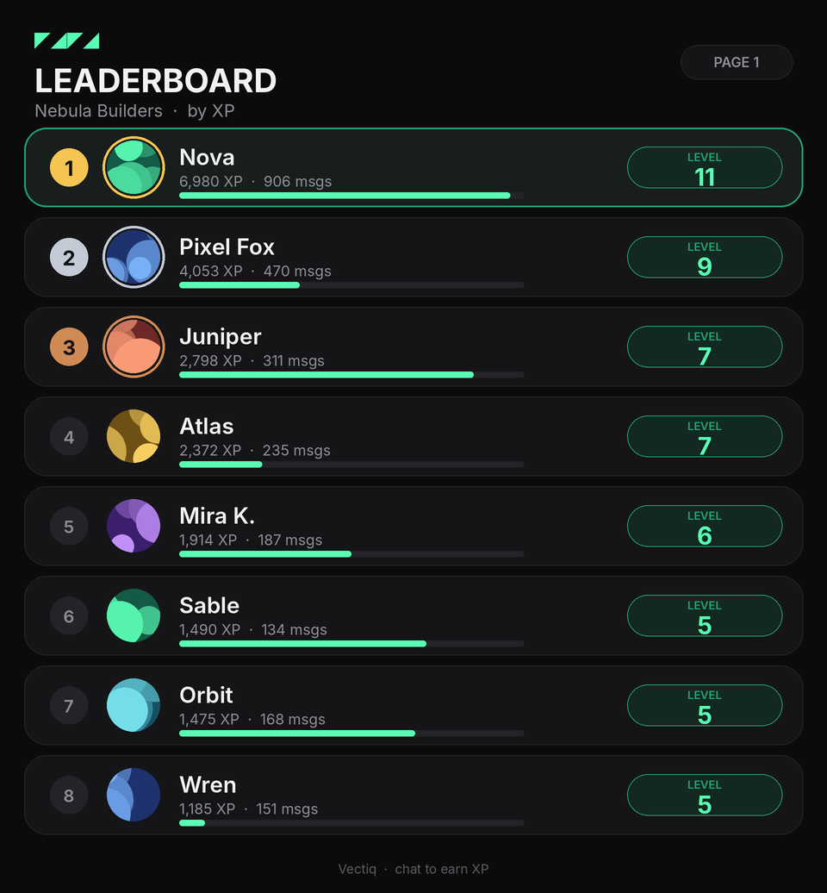

Members earn XP by chatting. XP adds up to levels, and each level needs more XP than the one before, so the first few levels come quickly and later ones take real time. You can reward levels with roles.



## How XP works

Each message earns a random amount of XP between `xp_min` and `xp_max`, at most once per `cooldown_seconds`. The defaults are 15 to 25 XP once a minute, so a very active member earns about 20 XP per minute at most. Spamming doesn't help, and neither do commands: messages that start with the command prefix earn nothing.

The curve is the same one MEE6 uses. Each step up costs 5*n*² + 50*n* + 100 XP, where *n* is the level you are leaving, and the totals add up:

| Level | Total XP | At 20 XP a minute |
|---|---|---|
| 1 | 100 | about 5 minutes of chat |
| 5 | 1,150 | about 1 hour |
| 10 | 4,675 | about 4 hours |
| 20 | 23,850 | about 20 hours |
| 30 | 67,525 | about 56 hours |

`!levelcurve` shows the XP needed for the next few levels at any time.

## Cards

`!rank` posts a card with the member's avatar, level, rank and progress to the next level. `!leaderboard` posts the top members as one image, and `!leaderboard 2` shows the next page. Both are drawn in Vector's colours.



Set `leveling.cards: false` if you would rather have plain text.

## Level-up messages

When someone levels up, the bot says so in the channel they were typing in, or in one fixed channel:

```yaml
leveling:
  announce: true
  announce_channel: ""        # blank = where they were typing
```

## Role rewards

Give a role at a level, from chat or from `config.yaml`:

```
!levelreward add 5 Regular
!levelreward remove 5
```

```yaml
leveling:
  rewards:
    5: Regular
    10: Veteran
```

Roles are created if they don't exist. Someone who reaches a level gets every reward up to it, so a member who joins late and jumps levels doesn't miss out.

## Keeping places XP-free

List channels where chatting should earn nothing, such as a spam or bot-commands channel:

```yaml
leveling:
  no_xp_channels: [bot-commands]
```

## Adjusting XP by hand

`!givexp @sam 500` adds XP (a negative number removes it) and `!resetxp @sam` wipes a member's XP. Both need Manage Roles.

## Commands

{{commands:Leveling}}

## Settings

{{config:leveling}}
