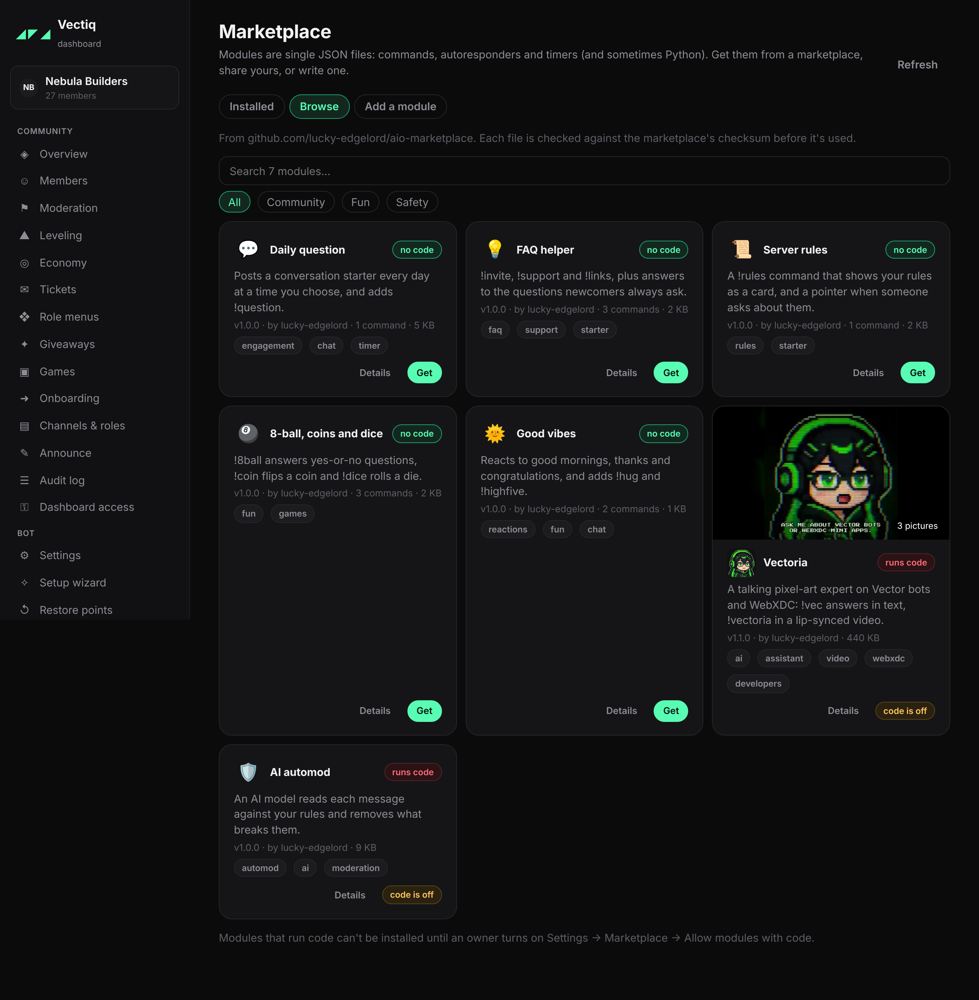

A marketplace is a GitHub repository of [JSON modules](json-modules.md). The default is [lucky-edgelord/aio-marketplace](https://github.com/lucky-edgelord/aio-marketplace), which also has a [website](https://lucky-edgelord.github.io/aio-marketplace/).



## On the dashboard

**Marketplace** (in the Bot section of the menu; owners only) has three tabs:

- **Installed:** the JSON modules you've added, each with an on/off switch, its settings, **Export** and **Remove**. Below them, every module you can save as a file.
- **Browse:** the marketplace's modules, searchable and grouped, each with its icon and, when it has them, a cover picture. **Details** shows its screenshots and previews, and what it does (commands, autoresponders, timers, settings, and for code, every file) before you add it. **Get** adds it and switches it on; a module you have gets **Update** when the marketplace has a newer file.
- **Add a module:** choose a file or paste JSON, start from the template, or copy a prompt for an AI. The module is checked as you type.

## In chat

Owners can use `!module market [word]` to list modules, `!module get <id>` to add one (it's switched on straight away) and `!module remove <id>`.

## Safety

- Vectiq only reads from `raw.githubusercontent.com`.
- Every file is checked against the SHA-256 the marketplace's catalog gives for it, and refused if it doesn't match.
- Pictures (icons, screenshots) are shown only from the marketplace's own `modules/media/` folder, never from other sites.
- Every module is checked before it's added; anything it can't use is left out, with a note.
- Modules without code can only say things, react and post on a timer.
- Modules with code need **Allow modules with code**, are added switched off, and show their files first.

## Using another marketplace

Settings → Marketplace, or in `config.yaml`:

```yaml
marketplace:
  repo: your-name/your-marketplace
  branch: main
  allow_code: false
```

A marketplace repository has `modules/catalog.json` and the module files next to it. The easiest start is to copy aio-marketplace: put your modules in `modules/`, run `python3 tools/make_catalog.py` (it checks every module with the same checker Vectiq uses and writes the catalog), and turn on GitHub Pages (branch `main`, folder `/docs`) for the website.
