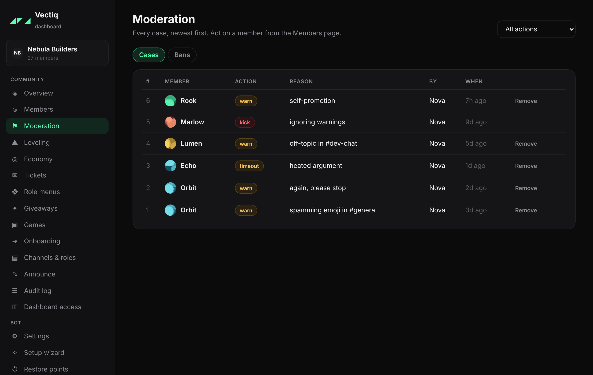

Every moderation action is stored as a numbered **case**, so you can see what happened, who did it and why. Commands need the matching Vector permission, so someone who can't time people out in Vector can't do it through the bot either.



## Warnings

```
!warn @sam spamming links
!warnings @sam
!delwarn 17
!clearwarns @sam
```

Each warning is a case. When someone reaches the threshold, the bot applies an action for you. With the defaults, a third warning gives a one-hour timeout, and the same happens again at six and nine:

```yaml
moderation:
  warn_threshold: 3
  warn_action: timeout       # timeout | kick | ban | none
  warn_action_minutes: 60
```

Set `warn_action: none` if you want warnings to be a record only.

## Timeouts, kicks and bans

```
!timeout @sam 30m spamming
!untimeout @sam
!kick @sam reason
!ban @sam reason
!tempban @sam 3d cooling off
!softban @sam keeps coming back
!unban npub1... reason
```

Durations are written as `30m`, `2h`, `1d12h`. A timeout can be at most `moderation.mute_max_days` (28 by default, which is Vector's own limit). A tempban lifts itself when the time is up. The bot checks every 30 seconds.

A **softban** takes the member's roles and removes them, then removes them again every time they come back. After `verification.softban_escalate` returns (3) it becomes a real ban. `!unban` lifts softbans too. See [Verification](verification.md#softbans).

The bot refuses to act on you, on itself and on the community owner, and says so instead of failing quietly.

## Looking things up

`!case 12` shows one case, `!history @sam` lists every case against a member, and `!modlog` shows the latest cases in the community.

To mirror every case into a channel for your moderators, set a log channel:

```yaml
moderation:
  log_channel: mod-log        # a channel name or id
```

## Cleaning up

- `!purge 25` deletes the last 25 messages in the channel (up to 100).
- `!lock` and `!unlock` stop and allow everyone from sending in the channel.
- `!slowmode 10` is a soft slowmode: messages posted faster than that are hidden. It applies per channel, and people with Manage Messages are exempt. `!slowmode 0` turns it off.

!!! note "Communities on the legacy roster"
    Vector communities still on the legacy roster don't accept per-channel permission changes, so `!lock` and `!unlock` may not work until the community is upgraded. Tickets have a fallback for this, and lock does not.

## Automod

Vectiq's automod is [Sentire](sentire.md): run your own copy, or invite the official Sentire-001. Older `config.yaml` files that switched automod on now switch Sentire on, and their banned words move to Sentire.

## Commands

{{commands:Moderation}}

## Settings

{{config:moderation}}
