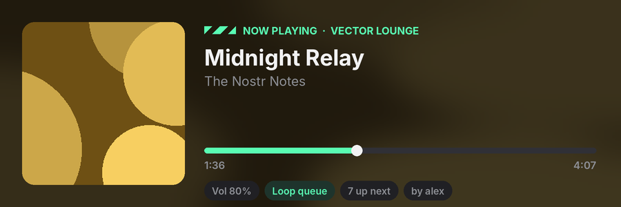
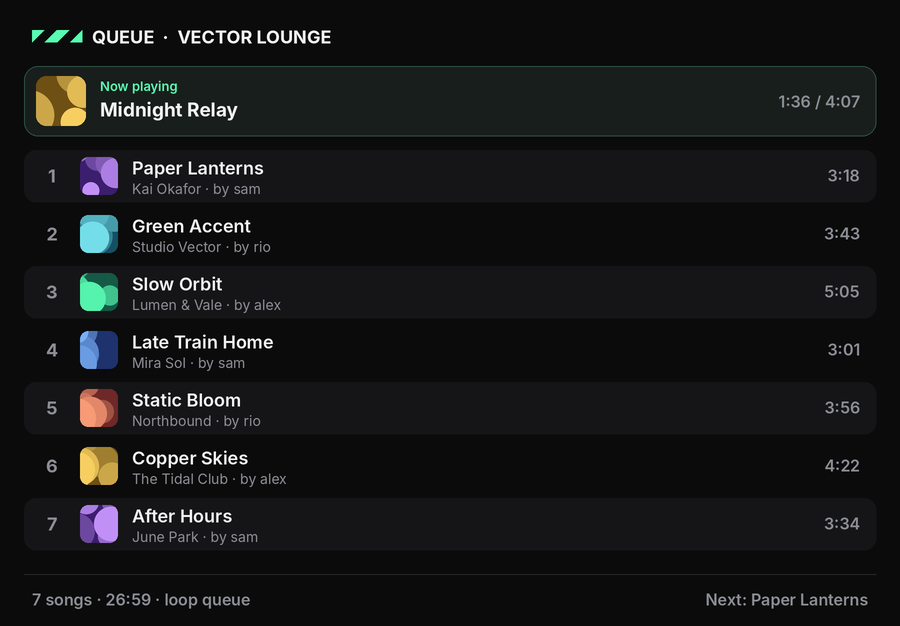

Vectiq plays music in Vector voice channels, with the commands people know from the big Discord music bots.

## Setup

Music needs [yt-dlp](https://github.com/yt-dlp/yt-dlp) and [ffmpeg](https://ffmpeg.org):

```sh
pip install "vectiq[music]"          # or .venv/bin/pip install -e ".[music]" in the bot's folder
brew install ffmpeg                  # macOS; apt install ffmpeg on Debian/Ubuntu; winget install ffmpeg on Windows
```

The Docker image includes ffmpeg; build it with `EXTRAS=dashboard,webhooks,music`. Then run `!module on music`.

## Playing

Join a voice channel, then:

```text
!play never gonna give you up
!play https://www.youtube.com/watch?v=...
!play https://soundcloud.com/...
!play https://www.youtube.com/playlist?list=...
```

`play` takes search words, or a link to YouTube, YouTube Music, SoundCloud, Bandcamp, a direct audio file, or anything else yt-dlp knows, including playlists. `search` shows the top five results to pick from. `playnext` puts a song at the front.

Mini games have their own command, `game`: `!game tictactoe`. See [Mini games](games.md).

## The queue

`queue` shows ten songs per page, and `nowplaying` shows a progress bar. You can `skip`, `skipto 4`, `back`, `remove 3`, `move 5 1`, `shuffle`, `clearqueue`, `removedupes`, and `leavecleanup` (drops songs from people who left). `loop` cycles through off, track and queue.

`seek 1:30` (or `seek +30`) jumps within a song, and `replay` starts it again. `volume 60` changes the volume straight away. `filter` adds an effect: bassboost, nightcore, vaporwave, slowed, speed, 8d, karaoke, treble, soft, loud or mono. `filter off` removes it.

## Cards and buttons



Each new song gets a **Now playing** card with the cover art, a progress bar, the volume, loop and filter, and who added it. Reaction buttons sit underneath:

| Button | Does |
|---|---|
| ⏯ | pause or resume |
| ⏭ | skip (a vote, unless you're a DJ or added the song) |
| ⏹ | stop and leave |
| 🔁 | cycle loop: off, track, queue |
| 🔀 | shuffle |
| 📜 | show the queue |

Reacting presses a button, and taking the reaction back presses it again, so you can press twice in a row. `nowplaying` posts a fresh card, and `queue` shows the queue as a card with covers.



Turn the pictures off with `cards: false`, or the buttons with `controls: false`.

## YouTube on servers

YouTube sometimes asks bots on data-centre servers to "sign in to confirm you're not a bot". At home this rarely happens. If it does, export a `cookies.txt` from a browser where you're signed in to YouTube (see [yt-dlp's guide](https://github.com/yt-dlp/yt-dlp/wiki/Extractors#exporting-youtube-cookies)) and set `cookies_file` to its path. SoundCloud and Bandcamp don't need this, and `search: scsearch` searches SoundCloud.

## Who's in charge

People with the **DJ** role (`dj_role`), staff with Manage Channels, and anyone alone with the bot control everything. Everyone else can add songs, remove their own, and **vote to skip**: once `vote_skip_ratio` of the listeners have voted, the song is skipped. Whoever added a song can always skip it. Leave `dj_role` empty to let everyone control the player.

The bot leaves when it's been alone for `leave_when_alone_seconds`, or has had nothing to play for `leave_when_idle_seconds`. `247` keeps it in the channel regardless.

!!! note "Audio streams"
    Songs stream through ffmpeg a few seconds ahead instead of being downloaded whole, so long mixes and live streams use little memory. Play only what you have the right to play in your community.

## Commands

{{commands:Music}}

## Settings

{{config:music}}
