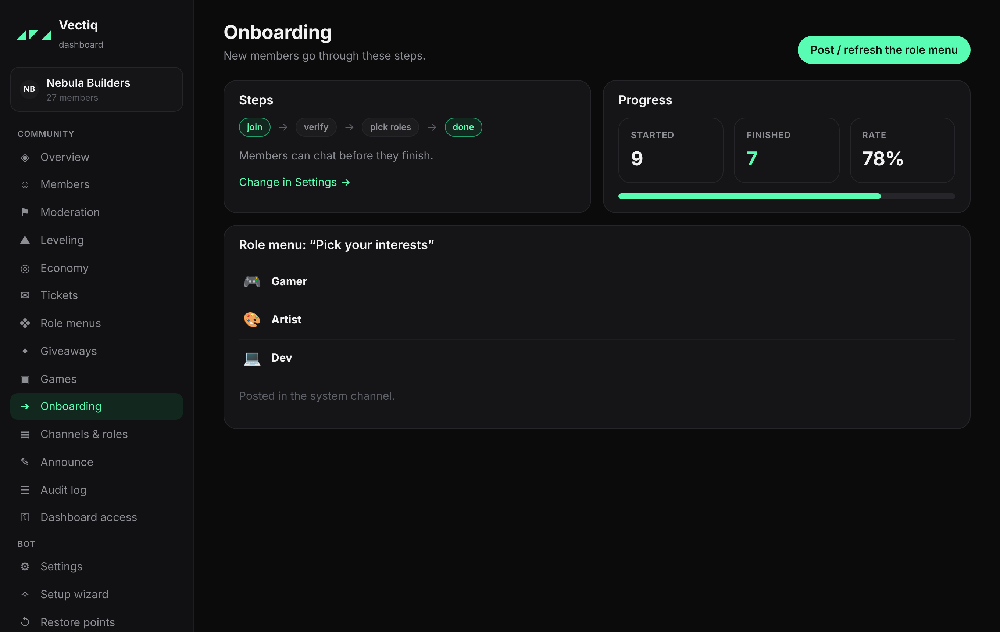

Three modules work together to look after a new member: **welcome** greets them, **verification** makes sure they are a person, and **onboarding** walks them through the steps and lets them pick roles. You can use any of them alone.



## Welcome messages

```yaml
welcome:
  enabled: true
  channel: general            # blank = the community's system channel
  message: "Welcome to {community}, {mention}! You are member #{count}."
  leave_message: "{name} has left {community}."
  leave_channel: goodbyes     # blank = the welcome channel
  dm_message: ""              # optional private message
```

The placeholders are `{mention}`, `{name}`, `{community}` and `{count}` (the number of members). `!testwelcome` previews the message in the channel. Staff need Manage Community to run it.

## Verification

Verification checks a new member is a person before they get the Verified role: by answering a question, reacting ✅, or passing a CAPTCHA on a web page. It can also hide messages until people verify, stop one device verifying many accounts, ask for a minimum age and run a separate lobby. It has its own page: [Verification](verification.md).

## Onboarding

Onboarding strings the steps together in order. The default is verify, then pick roles:

```yaml
onboarding:
  steps: [verify, pick_roles]
  channel: welcome
  required: false
  title: "Pick your interests"
  prompt: "Welcome! Pick your roles below, then say hi."
  done_message: "{mention} you're all set. Enjoy {community}!"
  role_menu:
    "🎮": Gamer
    "🎨": Artist
    "💻": Dev
```

The role menu is built from the `role_menu` list: emoji on the left, role name on the right, with the roles created if they don't exist. Members react to pick, and take the reaction back to drop the role. It is the same as a [role menu](role-menus.md) you would build by hand.

Progress is stored for each member. With `required: true`, a member finishes onboarding only once they have picked a role. When someone finishes, an `onboarding` event is sent, which a [webhook](webhooks.md) can mirror into a channel. `!onboarding` shows how many members have started and finished, and posts the role menu again if it is missing.

## Commands

{{commands:Welcome}}

{{commands:Onboarding}}

## Settings

### Welcome

{{config:welcome}}

### Onboarding

{{config:onboarding}}
