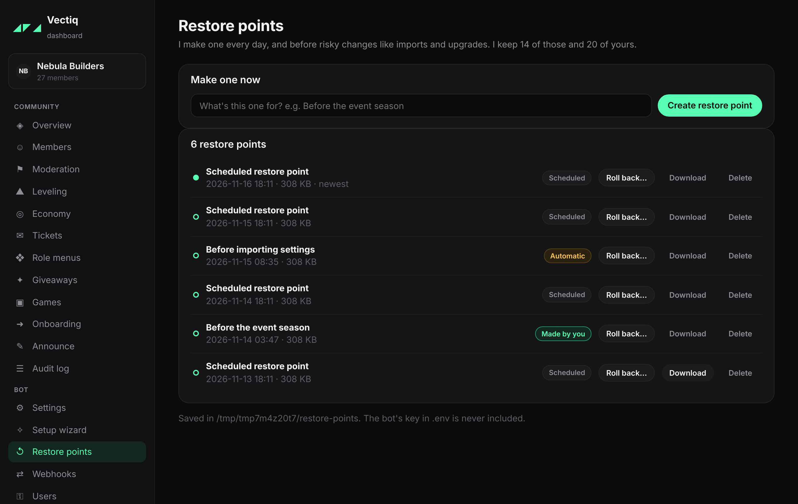

A restore point is a copy of everything the bot keeps: the database (levels, coins, tickets, events, warnings, verifications), `config.yaml`, the settings changed on the dashboard, and event pictures. Roll back to one and the bot goes back to that moment.

The bot's key in `.env` is **never** in a restore point, so a downloaded point can't be used to take over the bot. Keep your own copy of `.env` somewhere private.

## When points are made

- **On a schedule:** every `backup.every_hours` (24). Set it to 0 to turn scheduled points off.
- **Automatically, before something risky:** importing settings, saving the setup wizard, upgrading the database to a new version of Vectiq, and before every rollback.
- **By hand, whenever you like,** with a description so you can find it later: "before the event season".

The newest `keep_automatic` (14) scheduled and automatic points are kept, and the newest `keep_manual` (20) of yours. Older ones are deleted.

## Making one

| Where | How |
|---|---|
| Dashboard | **Restore points** → type a description → **Create restore point** |
| Chat (bot owners) | `!restorepoint create before the event season` |
| Terminal | `vectiq --backup "before the event season"` |

## Rolling back

Rolling back first makes a restore point of how things are right now, so you can always undo it by rolling back to that one.

| Where | How |
|---|---|
| Dashboard | **Restore points** → **Roll back…** on the point → confirm |
| Chat (bot owners) | `!restorepoint` lists them, then `!restorepoint rollback 3 confirm` |
| Terminal | `vectiq --list-backups`, then `vectiq --restore 3`. Stop the bot first. |

From the dashboard and chat, the rollback happens while the bot keeps running: the database is replaced in one step and settings reload. If the point had different features switched on, restart the bot to finish.

Messages the bot already sent in chat stay where they are. A point made by a newer version of Vectiq can't be restored by an older one; update first.

## Where they're kept

In `data/restore-points/`, one zip file each. Set `backup.dir` to keep them somewhere else, ideally another disk. Each zip opens with any archive tool and contains `vectiq.db`, `config.yaml`, `settings-export.yaml` and `event-images/`. You can also download one from the dashboard.

## Commands

{{commands:Restore points}}

## Settings

{{config:backup}}
