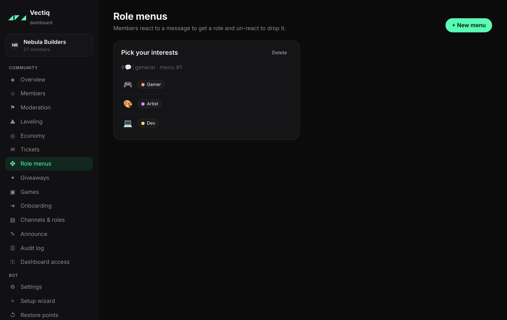

A role menu is a message with a list of roles. Members react with the matching emoji to get the role, and take the reaction back to lose it.



## Making a menu

```
!rolemenus create Pick your roles | 🎮=Gamer 🎨=Artist 💻=Dev
```

The title comes first, then a `|`, then `emoji=Role` pairs separated by spaces. Roles are created if they don't exist. Use an underscore for a space in a role name, so `🎵=Music_Lover` makes a role called `Music Lover`. The bot needs Manage Roles, and so do you.

The bot posts the menu in the channel you used the command in and adds each emoji as a reaction, so people have something to click.

## Managing menus

`!rolemenus list` shows every menu with its number, and `!rolemenus delete 3` removes one. You can also build and delete menus from the [dashboard](dashboard.md). The old name `!rolemenu` works too.

## Onboarding uses the same thing

The role menu that [onboarding](onboarding.md) posts for new members is an ordinary role menu, built from the `onboarding.role_menu` list in `config.yaml`.

## Commands

{{commands:Role menus}}
