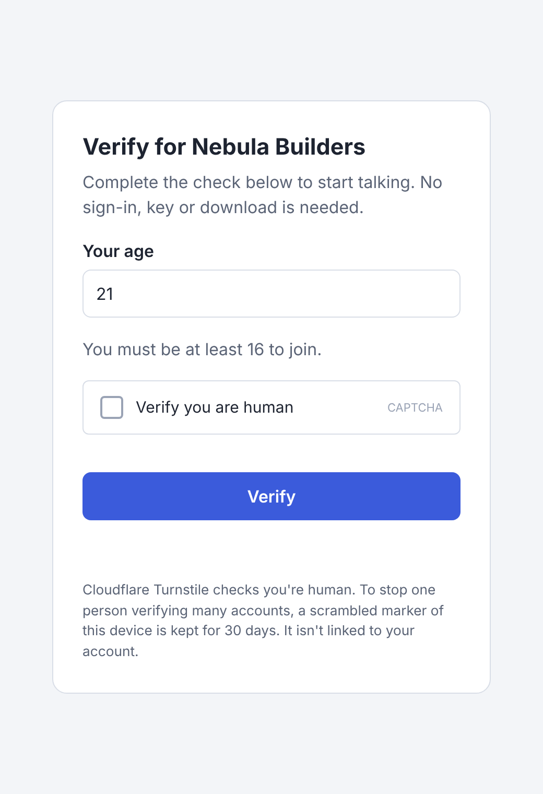

Verification makes sure new members are people before they can join in. Verified members get a role, and the bot remembers who verified, so a member who loses the role or leaves and rejoins gets it back without checking again.

The CAPTCHA page, the message gate, the device check, the age gate, the lobby and softbans are ported from [GateBot](https://gitworkshop.dev/henk.tech/Gatebot) by henk.tech (MIT).

## Choosing how members verify

```yaml
verification:
  mode: question        # question | button | captcha
  role: Verified        # given on success, created if missing
  channel: welcome      # where new members are greeted (blank = the system channel)
```

| Mode | What the member does | Good for |
|---|---|---|
| `question` | Answers a small sum: `!verify 12` | Small communities. Nothing to set up. |
| `button` | Reacts ✅ on the bot's message | The least effort for people, but also for bots. |
| `captcha` | Opens a personal link and passes a CAPTCHA | Communities that get spam accounts. Needs a web address and a CAPTCHA key. |

Use the Verified role to hide your other channels, so only verified members see them.

## CAPTCHA verification



When someone joins, the bot sends them a personal link by DM. The public notice in the channel only names the website, never the link, so nobody else can use it. If their DMs are closed, the link is posted in the channel instead and deleted after a minute. Each link works once and expires after `link_minutes` (10). A new link cancels the old one, and `!verify` asks for a fresh one.

To set it up:

1. Get a free site key and secret from [Cloudflare Turnstile](https://www.cloudflare.com/products/turnstile/), [hCaptcha](https://www.hcaptcha.com) or [reCAPTCHA](https://www.google.com/recaptcha). Any reCAPTCHA-compatible service works.
2. Put the **secret** in `.env`, never in `config.yaml`:

    ```sh
    CAPTCHA_SECRET=0x4AAAA...
    ```

3. Set the rest in `config.yaml`:

    ```yaml
    verification:
      mode: captcha
      public_url: https://verify.example.com     # blank = the dashboard's address
      captcha:
        provider: Cloudflare Turnstile
        site_key: 0x4AAAA...                        # the public key
        secret_key_env: CAPTCHA_SECRET
        verify_url: https://challenges.cloudflare.com/turnstile/v0/siteverify
        script_url: https://challenges.cloudflare.com/turnstile/v0/api.js?render=explicit
    ```

4. Restart. The page is served by the [dashboard](dashboard.md) when it's on, or by a small server of its own on the same address when it isn't. Put it behind HTTPS ([Deployment](deployment.md#the-dashboard-and-webhooks-over-https)).

`!verification` in chat tells you if anything is missing: a permission, the secret, the role, or HTTPS.

### One verification per device

With `device_check` on (the default), the bot keeps scrambled markers of the IP address, a cookie and the browser for `device_check_days` (30). They are keyed with a secret only your bot knows and are never stored next to the member who verified. A second account from the same device is stopped, and `on_duplicate` decides what happens:

| `on_duplicate` | What happens |
|---|---|
| `refuse` (default) | The page says no. Staff can verify them by hand with `!forceverify`. |
| `kick` | The second account is removed. It can rejoin. |
| `softban` | The second account is removed, and removed again whenever it comes back. |

Families, schools and shared Wi-Fi can look like one device, which is why the default only refuses. Tell members the check exists; the page says so too.

### Minimum age and an adults-only role

Set `min_age` and the page asks for an age first. Anyone younger is softbanned and removed. Set `adult_role` and members who said they were 18 or over can claim it with `!adult`. Both rely on what the member says, so treat them as a filter, not proof.

### A lobby: verify first, then get invited

With `invite_to`, the bot runs verification in a separate lobby community. Once someone passes, the bot invites them to the real community and removes them from the lobby a minute later. Members softbanned in the real community are removed from the lobby straight away.

```yaml
verification:
  mode: captcha
  invite_to: Nebula Builders     # the real community's name or id (!communityinfo shows the id)
```

## Hiding messages until people verify

```yaml
verification:
  gate: channel        # off | channel (only the verification channel) | all (every channel)
  spam_kick: 3         # gated messages in 15 minutes before a softban (0 = never)
```

With the gate on, messages from unverified members are deleted and they're pointed at verification again. Someone who keeps posting without verifying is softbanned after `spam_kick` messages. Staff are never gated, and `!verify` always gets through.

## Softbans

A softban takes the member's roles and removes them, then removes them again whenever they come back, whether they rejoin or post after rejoining while the bot was offline. After `softban_escalate` returns (3) it becomes a real ban. Softbans are kept in the bot's database rather than as a ban on the relay.

Staff softban with `!softban @sam reason`. `!unban` lifts a softban as well as a ban. Verification also softbans on its own: under the minimum age, spamming behind the gate, and (if you choose) a second account on one device.

## Staff tools

| Command | What it does |
|---|---|
| `!forceverify @sam` | Verify someone by hand |
| `!unverify @sam` | Take their verification and the verified and adult roles. In CAPTCHA mode their device stays marked, so they'll need `!forceverify` to come back. |
| `!verification` | How verification is set up here and anything stopping it |
| `!verification reset` | Forget every verification, link and device mark here. Roles already given stay. |

Verifications, refusals and softbans are noted in `verification.log_channel`, or the mod log when that's blank.

## Commands

{{commands:Verification}}

## Settings

{{config:verification}}
